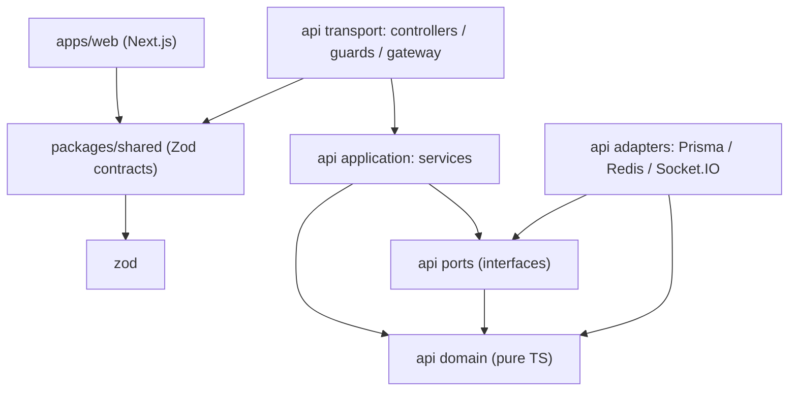
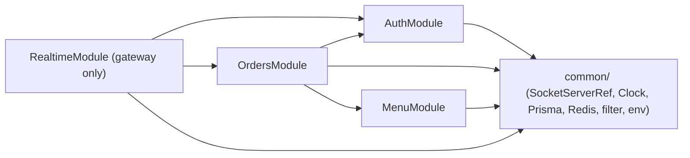
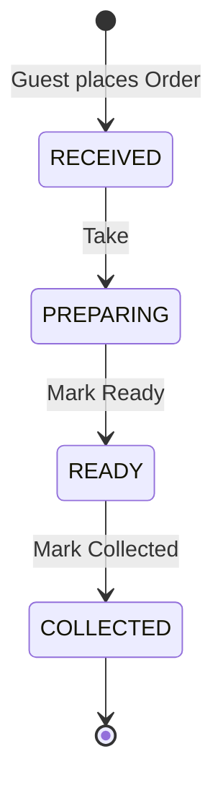
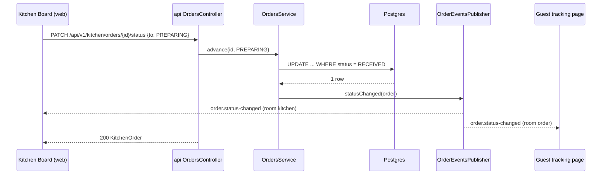
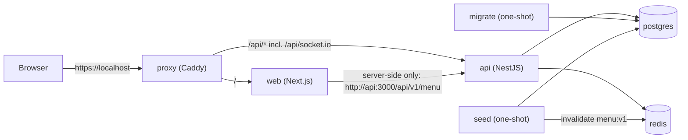
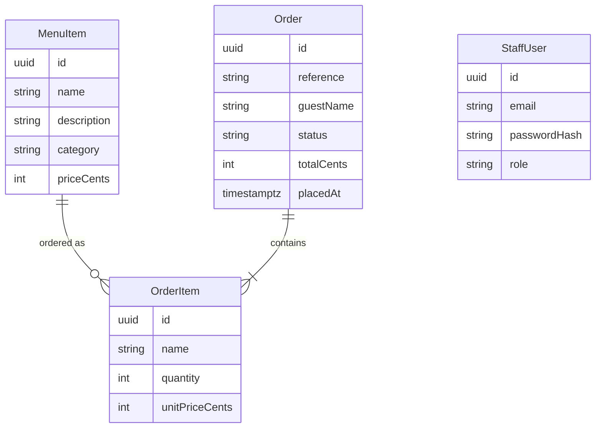

# Architecture Spine — restaurant

## Design Paradigm

**Modular monolith.** One NestJS app made of feature modules (`menu`, `orders`, `auth`, `realtime`), one Next.js app, and one **contract package** (`packages/shared`) that is the only code the two apps share. Rule-heavy modules (`orders`, `auth`) use a **pure domain core behind ports** (light Ports & Adapters, SOLID's dependency inversion); `menu` stays a plain service. Scope is the PRD §6.1 MVP only — anything beyond it waits (PRD §7 counter-metric).

| Layer (inside a rule-heavy module) | Directory | May import |
| --- | --- | --- |
| Transport — HTTP controllers, guards | `apps/api/src/<module>/*.controller.ts`, `*.guard.ts` | application, `@restaurant/shared` |
| Application — services, one use case per public method | `apps/api/src/<module>/*.service.ts` | domain, ports |
| Domain — entities, value objects, rules (pure TS) | `apps/api/src/<module>/domain/` | other domain files only |
| Ports — interfaces the application needs | `apps/api/src/<module>/ports/` | domain |
| Adapters — Prisma repositories, Redis stores, Socket.IO publisher | `apps/api/src/<module>/adapters/` | ports, domain, Prisma, Redis, `common/` |





Arrows are the only allowed import directions; no `forwardRef`. `packages/shared` never imports from `apps/*`; `apps/web` never imports from `apps/api`; domain never imports NestJS, Prisma, Redis, or Socket.IO.

## Invariants & Rules

### AD-1 — One pnpm-workspaces monorepo `[ADOPTED]`

- **Binds:** all
- **Prevents:** per-app copies of shared code; divergent package managers or build orchestration.
- **Rule:** One repo, pnpm workspaces only (no Turborepo/Nx). Exactly three workspace packages: `apps/api`, `apps/web`, `packages/shared` (name `@restaurant/shared`), linked with `workspace:*`. pnpm is pinned via `packageManager` in the root `package.json` (corepack in images). `pnpm-workspace.yaml` sets `injectWorkspacePackages: true`. Root scripts use `pnpm -r` (topological), except `dev`, which runs `docker compose -f compose.yaml -f compose.dev.yaml up`. Apps and tests run only in containers; the host runs only `pnpm install` (editor type resolution). Prod images: api via `pnpm deploy --filter api --prod <dir>`; web via Next `output: 'standalone'`.

### AD-2 — `packages/shared` is the wire contract, written as Zod `[ADOPTED]`

- **Binds:** FR-1–FR-9, all HTTP and WebSocket traffic
- **Prevents:** web and api describing the same payload twice and drifting; DB shape leaking to the browser.
- **Rule:** Every request body, response body, WebSocket event name/payload/ack, `OrderStatus`, and `ErrorCode` is defined once as a Zod schema in `packages/shared`; TS types are only `z.infer<>`. The api validates every inbound HTTP payload with the same schema (global `ZodValidationPipe`) and every inbound WS message with `schema.parse`; the web reuses them for forms and parses every response with them. `packages/shared` depends only on `zod` and holds **no** Prisma types, **no** business rules (transitions, pricing, expiry). The api prefix and every endpoint path, sub-paths and `:params` included, live once in `packages/shared/src/api-routes.ts` (`API_PREFIX`, `ApiRoutes` templates, `apiPath(route, params)`), matching AD-19 (amended 2026-10-19; full templates from Story 3.6). Built by `tsc` to CommonJS + `.d.ts` in `dist/`; the dev stack runs `tsc -w` on it so edits reach both apps.

### AD-3 — Module boundaries, import direction, data ownership

- **Binds:** apps/api, seed
- **Prevents:** Nest module import cycles; two modules writing one table or Redis key; rules leaking into controllers or Prisma calls.
- **Rule:** Module imports follow the second diagram above. Each Prisma model and Redis key namespace has one owning module; only its adapters touch it; other modules call the owner's exported service.

| Owner module | Prisma models | Redis keys |
| --- | --- | --- |
| `menu` | `MenuItem` | `menu:v1` |
| `orders` | `Order`, `OrderItem` | `guest:session:{sid}` |
| `auth` | `StaffUser` | `auth:session:{sid}`, `auth:refresh:{jti}` |
| `realtime` | — | — (Socket.IO rooms only) |

The Socket.IO `Server` is exposed through a dependency-free `common/socket-server.ref.ts` (set by the gateway in `afterInit`). `SocketIoOrderEventsPublisher` lives in `orders/adapters/`; auth logout disconnects sockets through the same ref. `realtime/` holds only the gateway (handshake + `order.subscribe`). The seed is the one sanctioned out-of-module writer (AD-11). Domain classes (`OrderStatusMachine`, `OrderReference`, `GuestSessionPolicy`, …) have no framework imports. Controllers parse, call one service method, map the result — no rules.

### AD-4 — Two principal types, one guard each, default deny

- **Binds:** FR-3, FR-6, FR-7, all endpoints and socket connections
- **Prevents:** a Guest Session credential satisfying a staff check; routes that forget authorization; tests and guards disagreeing on status codes.
- **Rule:** The principal is a discriminated union `{ kind: 'staff', staffId, sid, role } | { kind: 'guest', sid, orderId }`, where `role` is shared `StaffRole` (`KITCHEN` | `MANAGER`) (amended 2026-10-19, Epic 4). A global guard rejects any route that carries none of `@Public()`, `@UseGuards(StaffAuthGuard)`, `@UseGuards(GuestSessionGuard)`. `StaffAuthGuard` accepts only a valid `access_token` whose `sid` exists in Redis. Staff routes return `401 UNAUTHENTICATED` for anonymous callers **and** guests alike; `ManagerGuard` (a `PrincipalGuard` in `auth`) admits only `role: 'MANAGER'`: it throws `403 FORBIDDEN` for other staff and `401 UNAUTHENTICATED` exactly like `StaffAuthGuard` otherwise. `403 FORBIDDEN` is used only when a valid principal reaches a resource that is not its own or needs a role it lacks. Role checks live in guards, never in controllers or services. A future Customer is a third `kind` with its own guard.

### AD-5 — Staff session: JWTs in httpOnly cookies, revocable `[ADOPTED]`

- **Binds:** FR-6, FR-7
- **Prevents:** token plumbing differing between HTTP and WebSocket; a logged-out access token staying usable; each page inventing its own refresh.
- **Rule:**
  - Login sets `access_token` (JWT 5 min, claims `staffId`, `sid`, `role`, `Path=/`) and `refresh_token` (JWT 1 h, claims `sid`, `jti`, `Path=/api/v1/auth`), both `HttpOnly; Secure; SameSite=Strict`.
  - Redis: `auth:session:{sid}` → `staffId` and `auth:refresh:{jti}` → `sid` (token strings are never stored; the JWT signature proves authenticity, Redis proves it's still live). Refresh consumes the presented `jti` atomically (`GETDEL`) and issues a new pair; an unknown `jti` → 401. Refresh re-reads `role` from `StaffUser` (a missing account → 401), so a role change applies within one access-token lifetime. Logout deletes both keys and calls `server.in('staff-session:{sid}').disconnectSockets()`.
  - Passwords hashed with argon2id behind a `PasswordHasher` port (seed uses the same adapter). Wrong email or password → one generic `INVALID_CREDENTIALS`.
  - Web: `apps/web/lib/api.ts` is the only fetch wrapper. On 401 from a staff route it calls `POST /api/v1/auth/refresh` once (single-flight per tab) and retries; a second 401 navigates to `/kitchen/login`. Socket `connect_error` with `UNAUTHENTICATED` runs the same refresh, then reconnects. JavaScript never reads a token.

### AD-6 — Guest Session: opaque id, one resolver `[ADOPTED]`

- **Binds:** FR-3, FR-4
- **Prevents:** a JWT scheme for guests diverging from staff auth; placement, guard, and socket each reading "valid session" differently.
- **Rule:** Placing an Order sets cookie `guest_session` (opaque 128-bit CSPRNG id, `HttpOnly; Secure; SameSite=Strict; Path=/`, `Expires = placedAt + 24 h`) and Redis `guest:session:{sid}` → `orderId`. `GuestSessionService.resolve(sid)` (orders application layer) is the **only** implementation of validity: key present **and** Order not *Collected* **and** `clock.now() < placedAt + 24 h`; otherwise it deletes the key and returns `null`. `GuestSessionGuard`, the gateway handshake, and the place-order use case all call it. Placement is `@Public()`; if `resolve` returns a session → `409 ORDER_ALREADY_OPEN` with `details.reference`. The web tracking route `/track` loads `GET /api/v1/orders/current`; 401 → redirect to `/` (fresh start). Supersedes the addendum's "guest refresh token".

### AD-7 — Order lifecycle: forward-only state machine, applied atomically

- **Binds:** FR-8, FR-9
- **Prevents:** two Kitchen Staff both "succeeding" on the same Order; transition rules duplicated in UI and api.
- **Rule:** `OrderStatusMachine` (domain) alone knows `RECEIVED → PREPARING → READY → COLLECTED` and that `COLLECTED` is final; it maps a requested `to` to its required predecessor. The api applies it as one conditional write — `UPDATE … WHERE id = :id AND status = :predecessor` — and 0 rows → `409 INVALID_TRANSITION`. The web may hide buttons but never decides validity.



### AD-8 — Identifiers

- **Binds:** FR-2, FR-4
- **Prevents:** sequential ids in URLs (IDOR); two notions of "the order id" on the client.
- **Rule:** Every primary key is a UUID. `Order.reference` is a separate unique column: 6 chars `[A-Z0-9]`, CSPRNG, generated by `OrderReference` (domain), retried on unique-constraint collision. Guest-facing payloads (`GuestOrderView`, events to `order:{id}` rooms) carry the reference, never the UUID; staff payloads (`KitchenOrder`) add the UUID. Lookup normalizes to upper case. Unknown or expired reference → same `404 ORDER_NOT_FOUND`. The HTTP lookup and `order.subscribe` share one throttle; the api sets `trust proxy` so limits are per client, not per Caddy.

### AD-9 — Money, prices, retention

- **Binds:** FR-1, FR-2, NFR-retention
- **Prevents:** floating-point prices; trusting a client price; old Orders changing when the Menu changes.
- **Rule:** Money is integer cents (`priceCents`, `unitPriceCents`, `totalCents`) in DB, schemas, and UI state; formatting only at render. The api ignores client prices and copies `MenuItem.name` and `MenuItem.priceCents` into `OrderItem.name` / `OrderItem.unitPriceCents` at placement; `Order.totalCents` is computed server-side. Order reads never join `MenuItem`. `OrderItem → MenuItem` FK is `onDelete: Restrict`. Orders are never deleted.

### AD-10 — Live updates: Socket.IO, server-assigned rooms, emit after commit `[ADOPTED]`

- **Binds:** FR-5, FR-8
- **Prevents:** clients joining rooms they don't own; events for rolled-back writes; boards drifting or moving backwards after reconnects.
- **Rule:**
  - Socket.IO at path `/api/socket.io`. The client never names a room. Handshake reads cookies: valid staff → rooms `kitchen` + `staff-session:{sid}`; `GuestSessionService.resolve` hit → `order:{orderId}`. Without a session a client may send `order.subscribe { reference }` (validated like the HTTP lookup) → joins `order:{orderId}`; ack is `{ ok: true } | { error }` (shared schema).
  - Only `OrdersService` publishes, after the DB write commits, through the `OrderEventsPublisher` port (Socket.IO adapter now, RabbitMQ later).
  - Events: `order.created` → `kitchen`, payload `KitchenOrder`; `order.status-changed` → `kitchen` with `{ id, reference, status, changedAt }` and → `order:{id}` with `{ reference, status, changedAt }`.
  - Clients refetch the HTTP snapshot on every (re)connect, then apply events; an event is applied only if its status ranks later than the one held (forward-only display order).



### AD-11 — Menu cache and seed

- **Binds:** FR-1, seed
- **Prevents:** seed and api disagreeing on the cache key; stale or empty Menu after re-seed; seed destroying retained Orders.
- **Rule:** `MenuService` is the only reader/writer of `menu:v1` (whole grouped Menu JSON, no TTL): hit → return; miss → load from Postgres, write (never cache an empty Menu), return. The seed **upserts** Menu Items by fixed UUIDs and staff and the manager by unique `email`, each with its `role`, never deletes, then calls `MenuCache.invalidate()`. It boots a `SeedModule` importing only `MenuModule`, the `PasswordHasher` adapter, Prisma and Redis. Staff demo credentials come from `SEED_STAFF_EMAIL` / `SEED_STAFF_PASSWORD` (role `KITCHEN`) and `SEED_MANAGER_EMAIL` / `SEED_MANAGER_PASSWORD` (role `MANAGER`).

### AD-12 — Frontend data access and rendering

- **Binds:** apps/web
- **Prevents:** code that works locally but fails in Docker; the Menu being frozen into the image at build.
- **Rule:** Only Next.js server code uses `API_INTERNAL_URL` (`http://api:3000`), and only for the public Menu page, which is dynamic (`export const dynamic = 'force-dynamic'`) and calls `${API_INTERNAL_URL}/api/v1/menu`. Browser code (tracking, Kitchen Board, login) uses `lib/api.ts` against same-origin `/api/v1/...` and Socket.IO on the same origin. Web env is parsed at server start (`instrumentation.ts`), never at `next build`; `next build` needs no api and no secrets. Kitchen route protection is client-side via the 401 flow (AD-5), not Next `proxy.ts`. All responses are parsed with shared schemas. Menu and tracking pages are mobile-first; Kitchen Board targets tablet/desktop.

### AD-13 — One error envelope, closed code set `[ADOPTED]`

- **Binds:** all HTTP endpoints, WS acks
- **Prevents:** the web parsing message strings; agents inventing synonym codes.
- **Rule:** Every non-2xx body is `{ error: { code: ErrorCode, message: string, details?: unknown } }`, produced by one global exception filter from domain errors. `ErrorCode` (shared `z.enum`) is exactly: `VALIDATION_FAILED` 400, `MENU_ITEM_NOT_FOUND` 400, `UNAUTHENTICATED` 401, `INVALID_CREDENTIALS` 401, `FORBIDDEN` 403, `ORDER_NOT_FOUND` 404, `ORDER_ALREADY_OPEN` 409, `INVALID_TRANSITION` 409, `RATE_LIMITED` 429, `INTERNAL` 500. Adding a code means editing this list. The web branches on `code`, never `message`.

### AD-14 — Configuration fails fast `[ADOPTED]`

- **Binds:** apps/api, apps/web, compose
- **Prevents:** a container starting with a missing secret; one-shot containers missing env the api requires.
- **Rule:** Each app parses its env with a Zod schema at start and exits on failure. `api`, `migrate`, and `seed` share `env_file: .env`. Secrets live only in gitignored `.env`; a complete `.env.example` is committed. No secret defaults in code.

### AD-15 — Containers and environments `[ADOPTED]`

- **Binds:** all; build step 1
- **Prevents:** dev, test, and CI running different topologies; migrations racing app start; proxy and api disagreeing on paths.
- **Rule:**
  - `compose.yaml`: `proxy` (Caddy, `tls internal`, `/data` on a named volume), `web`, `api`, `postgres`, `redis`, one-shot `migrate` (`prisma migrate deploy`) then `seed`. Order: `postgres`/`redis` healthy → `migrate` done → `seed` done → `api` healthy (`GET /api/v1/health`) → `web` → `proxy`.
  - Only `proxy` publishes a host port (443). Caddy forwards `/api/*` **unmodified** to `api:3000`; everything else to `web:3000`. The api owns the `/api/v1` prefix (`setGlobalPrefix`) and the Socket.IO path.
  - `compose.dev.yaml` (override): `web`/`api` on the Dockerfile `dev` target, source bind-mounted, `node_modules` in named volumes (never from the host), hot reload, plus a `shared` watcher.
  - `compose.test.yaml` (override): adds unpublished `postgres-test` / `redis-test` and a one-shot `api-test` runner (api `dev` target) with `TEST_DATABASE_URL` / `TEST_REDIS_URL` pointing at them over the compose network. Integration runs via `docker compose -f compose.yaml -f compose.test.yaml run --rm api-test`. Proxy-only has no exceptions.
  - One multi-stage Dockerfile per app (`dev`, `prod`). Postgres volumes mount at `/var/lib/postgresql` (PG 18 image layout).



### AD-16 — Testing against real infrastructure, time under control `[ADOPTED]`

- **Binds:** NFR-tests, CI
- **Prevents:** green tests on mocked infrastructure; expiry tests that can't be written; flaky tests deleting each other's data.
- **Rule:**

| Level | Tool | Scope | Infra |
| --- | --- | --- | --- |
| Unit | Vitest (`unplugin-swc` in api) | domain classes, services with in-memory port fakes, shared schemas, web components (Testing Library) | none |
| Integration | Vitest + Supertest on the real Nest app | every endpoint; PRD §5 list: FR-2, FR-3 incl. expiry, FR-4 24 h window, FR-6 login/refresh/logout/revocation, FR-7 every protected route rejects guest + anonymous, FR-9 | real Postgres + Redis in `postgres-test` / `redis-test` (compose network, via `TEST_DATABASE_URL` / `TEST_REDIS_URL`); runs inside the `api-test` container, locally and in CI |
| E2E | Playwright (`ignoreHTTPSErrors`) | UJ-1 + UJ-2 in two browser contexts, incl. < 2 s live update | full compose stack; Playwright runs in a container (runner details in Story 3.5) |

- Integration/e2e never mock Postgres or Redis. Integration runs with `fileParallelism: false`; `globalSetup` runs `prisma migrate deploy` once; each file truncates tables and flushes Redis in `beforeEach`, then builds its data with TypeScript fixture builders (`buildMenuItem`, `buildOrder`, `buildStaffUser`) through Prisma. No file depends on another's data.
- **Expiry is decided in code against an injected `Clock` port**: guest `placedAt + 24 h`, reference lookup window, and JWT verification (`clockTimestamp` from `Clock`). Redis TTLs are cleanup only, set from the same `Clock`. Tests advance the fake clock.
- Supertest tests carry cookies by copying `Set-Cookie` into a `Cookie` header (one helper), since `Secure` cookies aren't replayed over http.

### AD-17 — Code quality gates `[ADOPTED]`

- **Binds:** all code
- **Prevents:** inconsistent style between agents; code a reviewer can't follow.
- **Rule:** Every class, method, property, function, type, and Zod schema — exported or not — has a TSDoc comment stating **what it is for**. Patterns are named in TSDoc where used (Repository, State machine, Adapter, Guard). SOLID applies; no abstraction without a second implementation or a test fake that needs it. One root `eslint.config.mjs` (typescript-eslint type-aware via `projectService`, `@next/eslint-plugin-next` for web) + Prettier + `eslint-config-prettier`; `pnpm lint`, `pnpm format:check`, `pnpm typecheck` pass with zero warnings. tsconfigs set `types` explicitly and don't use `baseUrl` (TS 6).

### AD-18 — CI on GitHub Actions `[ADOPTED]`

- **Binds:** repo
- **Prevents:** merging code that only passes on one machine.
- **Rule:** One workflow on every push/PR: install (frozen lockfile) → lint + format check → typecheck → unit → integration (`docker compose … run --rm api-test`, same command as local) → build `api` and `web` prod images. Playwright e2e on `main` and nightly against the compose stack.

### AD-19 — API surface

- **Binds:** FR-1–FR-9, apps/web, apps/api
- **Prevents:** web and api inventing different paths, bodies, or Order shapes.
- **Rule:** These are the MVP endpoints; schemas named here live in `packages/shared`. `GuestOrderView` = `{ reference, guestName, status, items[{ name, quantity, unitPriceCents }], totalCents, placedAt }`; `KitchenOrder` = `GuestOrderView` + `id`. `StaffMe` = `{ id, email, role }`. "Staff" in the Guard column admits both roles.
- **Paths:** the `/api/v1` prefix and every endpoint path (full template, e.g. `orders/by-reference/:reference`) are defined once in `packages/shared/src/api-routes.ts`; the api and web read them from there, and `apiPath` encodes params. Until Story 3.6 lands, sub-paths are still typed in controller decorators and `apps/web/lib/api.ts`. The compose api healthcheck URL and the tests keep literal `/api/v1` paths on purpose.

| Method + path | Guard | Request | Response |
| --- | --- | --- | --- |
| `GET /api/v1/health` | Public | — | `{ ok: true }` |
| `GET /api/v1/menu` | Public | — | `MenuResponse` (grouped by category) |
| `POST /api/v1/orders` | Public (+ `resolve`) | `PlaceOrderRequest` `{ guestName, items[{ menuItemId, quantity }] }` | `201 GuestOrderView` + `guest_session` cookie |
| `GET /api/v1/orders/current` | GuestSession | — | `GuestOrderView` |
| `GET /api/v1/orders/by-reference/:reference` | Public, throttled | — | `GuestOrderView` |
| `POST /api/v1/auth/login` | Public | `LoginRequest` `{ email, password }` | `200 StaffMe` + cookies |
| `POST /api/v1/auth/refresh` | refresh cookie | — | `204` + rotated cookies |
| `POST /api/v1/auth/logout` | Staff | — | `204`, cookies cleared |
| `GET /api/v1/auth/me` | Staff | — | `StaffMe` |
| `GET /api/v1/kitchen/orders` | Staff | — | `KitchenOrder[]` (not COLLECTED, `placedAt` ascending) |
| `PATCH /api/v1/kitchen/orders/:id/status` | Staff | `AdvanceStatusRequest` `{ to: OrderStatus }` | `200 KitchenOrder` |
| `GET /api/v1/manager/orders?status=` | Manager | `ManagerOrdersQuery` `{ status?: OrderStatus }` | `ManagerOrdersResponse` `{ counts: Record<OrderStatus, number>, orders: KitchenOrder[] }` (`placedAt` descending, max 100) |

## Consistency Conventions

| Concern | Convention |
| --- | --- |
| Naming — files | kebab-case: `orders.service.ts`, `order-status-machine.ts`, `prisma-order.repository.ts` |
| Naming — code | Classes/types PascalCase; schema `PlaceOrderRequestSchema` → type `PlaceOrderRequest`; ports by role (`OrderRepository`), adapters by tech + role (`PrismaOrderRepository`) |
| Naming — events | `<entity>.<past-tense>` kebab: `order.created`, `order.status-changed`; commands `<entity>.<verb>`: `order.subscribe` |
| Naming — Redis | `<owner>:<thing>:{id}`; see AD-3 |
| Naming — "proxy" | "proxy" means the Caddy container; Next's `proxy.ts` is unused in MVP |
| API | `/api/v1/<resource>`, JSON camelCase; see AD-19 |
| Dates | ISO-8601 UTC strings on the wire (`z.iso.datetime()`); `timestamptz` in Postgres |
| Order Status | `RECEIVED`, `PREPARING`, `READY`, `COLLECTED` (shared `z.enum`; Prisma enum mirrors it) |
| Logging | Nest `Logger` per class (`new Logger(ClassName.name)`); order lines include `reference`; never log tokens, passwords, cookies |
| Errors | Throw domain errors carrying an `ErrorCode`; the global filter maps them (AD-13) |
| Next 16 | `params`, `searchParams`, `cookies()` are async — always `await` |

## Stack

| Name | Version |
| --- | --- |
| Node.js (all images) | 24 LTS |
| pnpm | 11.28.x (`packageManager`) |
| TypeScript | ~6.0.3 (not 7: Nest CLI needs the JS compiler API) |
| NestJS (`@nestjs/*` incl. `platform-socket.io`; scaffold with `@nestjs/cli@11`) | 11.2.x (npm tag `legacy`; not 12 — nestjs-zod peers ^11) |
| nestjs-zod | 5.5.x |
| @nestjs/throttler | 6.7.x |
| Socket.IO (server + client) | 4.8.x |
| Next.js | 16.4.x (`output: 'standalone'`) |
| React | 19.3.x |
| Zod | 4.x |
| Prisma ORM (`prisma`, `@prisma/client`, `@prisma/adapter-pg`, `pg`) | ^7.10 — never unpinned (npm `latest` is 8 RC); `apps/api/prisma.config.ts` reads `DATABASE_URL` from the process env (compose `env_file`), never loads `.env`; generator `prisma-client`, `output ../src/generated/prisma`, `moduleFormat = "cjs"` |
| argon2 | 0.45.x |
| PostgreSQL (image) | `postgres:18.6-alpine` |
| Redis (image) | `redis:8.10.2-alpine` |
| Caddy (image) | `caddy:2.11.7-alpine` |
| Vitest + unplugin-swc + @swc/core | 5.0.x + 2.x + 1.16.x |
| Playwright | 1.64.x |
| ESLint + typescript-eslint | 10.x + 8.x, flat config |
| Prettier + eslint-config-prettier | 3.x + ≥ 10.1.8 |
| CI | GitHub Actions |

## Structural Seed

```text
restaurant/                  # repo root (package scope @restaurant)
  apps/
    api/                      # NestJS
      prisma/schema.prisma    # owned by api; migrations in prisma/migrations
      prisma.config.ts
      src/
        menu/                 # plain service + MenuCache
        orders/               # domain/ ports/ adapters/ (incl. SocketIoOrderEventsPublisher) + controllers, services, GuestSessionGuard
        auth/                 # domain/ ports/ adapters/ + StaffAuthGuard, controller
        realtime/             # Socket.IO gateway only
        common/               # SocketServerRef, Clock, Prisma/Redis providers, exception filter, env schema, @Public(), global guard
        seed/                 # SeedModule + script
        generated/prisma/     # Prisma client output (gitignored)
      test/                   # integration + fixture builders + cookie helper
      Dockerfile
    web/                      # Next.js App Router
      app/                    # / (menu), /track, /track/[reference], /kitchen, /kitchen/login, /manager
      lib/api.ts              # single fetch wrapper + refresh
      e2e/                    # Playwright
      Dockerfile
  packages/
    shared/                   # Zod schemas, OrderStatus, ErrorCode, WS events
  compose.yaml  compose.dev.yaml  compose.test.yaml  Caddyfile
  eslint.config.mjs  .prettierrc  .env.example  pnpm-workspace.yaml
  .github/workflows/ci.yml
```



**Build order** — step 1 is the stack: (1) pnpm workspace skeleton + Dockerfiles + compose stack running (proxy, web hello page, api `/health`, postgres, redis, migrate, seed) with dev hot reload; (2) lint/format/typecheck + CI skeleton; (3) `packages/shared` contracts; (4) features.

## Capability → Architecture Map

| Capability / Area | Lives in | Governed by |
| --- | --- | --- |
| FR-1 View Menu | `api/menu`, `web/app/page.tsx` (dynamic) | AD-9, AD-11, AD-12, AD-19 |
| FR-2 Place Order | `api/orders`, `PlaceOrderRequestSchema` | AD-2, AD-6, AD-8, AD-9, AD-19 |
| FR-3 Guest Session | `api/orders` (`GuestSessionService`, guard), `web/app/track` | AD-4, AD-6, AD-16 |
| FR-4 Track by reference | `api/orders`, `web/app/track/[reference]` | AD-6, AD-8, AD-16 |
| FR-5 Real-time status | `api/realtime`, `orders/adapters` publisher, web tracking page | AD-3, AD-10 |
| FR-6 Staff login/logout | `api/auth`, `web/app/kitchen/login`, `web/lib/api.ts` | AD-5, AD-16 |
| FR-7 Role-based authz | global guard + guards in `auth`/`orders` | AD-4, AD-16 |
| FR-8 View board | `api/orders` kitchen controller, `web/app/kitchen` | AD-10, AD-12, AD-19 |
| FR-9 Advance status | `api/orders` domain + adapter | AD-7 |
| FR-10 Manager login/landing | `api/auth` (role claim, `ManagerGuard`), `web/app/kitchen/login` | AD-4, AD-5, AD-11 |
| FR-11/FR-12 Manager Dashboard, all Orders | `api/orders` manager controller, `web/app/manager` | AD-4, AD-10, AD-19 |
| FR-13 Manager advances | existing kitchen routes | AD-4, AD-7 |
| NFR security / retention / tests / responsive | cross-cutting | AD-4, AD-5, AD-8, AD-9, AD-12, AD-16 |
| Containerization, CI, quality | repo root | AD-1, AD-14, AD-15, AD-17, AD-18 |

## Deferred

| Item | Why it can wait / revisit when |
| --- | --- |
| Clean Architecture / DDD + CQRS (option C) | Post-MVP direction; AD-3's pure domain + ports keep it additive. Revisit with kitchen sections. |
| RabbitMQ | PRD defers; plugs in as a second `OrderEventsPublisher` adapter. |
| Socket.IO Redis adapter / >1 api replica | Single api container in MVP. |
| Refresh-token reuse detection; two-tab refresh race | Rotation + revoke covers FR-6; a lost race just re-logs in. Revisit with customer accounts. |
| Customer accounts / order history / coupons | Third principal per AD-4; Orders already retained with name/price snapshots. |
| Public hosting, real TLS certs, backups, Redis persistence tuning | Demo runs locally and in CI only. |
| Structured logging, metrics, tracing | Built-in Logger suffices for the demo. |
| Client data-fetching library | `lib/api.ts` + socket state covers three pages. |
| Staff/user management UI; pagination and date filters on the all-Orders list | Seeded accounts and 100 newest suffice for Phase 2; revisit with reports. |
| OpenAPI docs | Generate from Zod (`z.toJSONSchema`) later. |
| Exact patch versions | Locked in lockfile / image tags at scaffold. |
